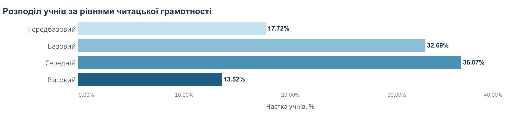

# Як самостійно викласти доповідь на GitHub

Це коротка інструкція без командного рядка. Працюйте через браузер.

## Крок 1. Створіть репозиторій

1. Увійдіть до https://github.com/.
2. Натисніть **+ → New repository** (або відкрийте https://github.com/new).
3. **Repository name:** `ukraine-reading-literacy-2024`.
4. **Description:** `Аналіз читацької грамотності четвертокласників України (2024): навчальна тривожність і підтримка родини`.
5. Оберіть **Public**. **Не вмикайте Add a README**, якщо збираєтеся завантажувати готовий `README.md` з пакета.
6. Натисніть **Create repository**.

## Крок 2. Додайте готові файли

1. Розпакуйте ZIP із проєктом на комп'ютері.
2. У новоствореному GitHub-репозиторії натисніть **uploading an existing file** (або **Add file → Upload files**, якщо цей пункт уже є).
3. Перетягніть **вміст папки** `ukraine-reading-literacy-2024` — файли `README.md`, `report.md`, `PUBLISHING_GUIDE.md` та папки `images`, `sql`, `dashboard`. Не потрібно вкладати ще одну папку з назвою репозиторію.
4. Унизу введіть коментар `Add reading literacy analysis and charts`, натисніть **Commit changes** (формулювання підтвердження в інтерфейсі може змінюватися).
5. Поверніться на головну сторінку репозиторію. Текст `README.md` з'явиться автоматично.

**Якщо сайт не приймає всі папки разом:** завантажуйте спочатку файли `README.md` і `report.md`, потім відкрийте/створіть відповідну папку та завантажте її вміст окремо.

## Крок 3. Подивіться, як вставлені зображення в середину тексту

1. У репозиторії натисніть на `report.md`.
2. Графік №1 має з'явитися одразу після підзаголовка `5.1. Загальний рівень читацької грамотності`.
3. Решта чотирьох графіків — у відповідних підрозділах доповіді.
4. Щоб зрозуміти, як це працює, відкрийте `report.md`, натисніть **олівець / Edit this file** і знайдіть рядок:

```markdown

```

- `!` означає: показати зображення, а не просто посилання;
- текст у квадратних дужках — опис графіка;
- шлях у круглих дужках — де лежить PNG у цьому репозиторії.

**Важливо:** папка `images` має бути поряд із файлом `report.md`, а назви PNG у коді й у папці — збігатися точно.

## Крок 4. Як додати власний новий графік з Tableau

1. У Tableau відкрийте потрібний worksheet.
2. Використайте **Worksheet → Export → Image** (якщо доступно у встановленій версії) і збережіть PNG.
3. На GitHub відкрийте папку `images`, натисніть **Add file → Upload files**, виберіть PNG та підтвердьте збереження.
4. Відкрийте `report.md` через **Edit this file**.
5. Вставте між потрібними абзацами рядок із точною назвою файла, наприклад:

```markdown

```

6. У вкладці **Preview** перевірте результат і натисніть **Commit changes**.

## Крок 5. Що саме публікуємо

- **Так:** підсумкова доповідь, PNG-графіки, SQL-код, PDF дашборду, посилання на офіційні дані.
- **Лише після перевірки:** знеособлені агреговані CSV із результатами, якщо хочете показати таблиці, з яких побудовані графіки.
- **Не завантажуйте:** робочу базу `ukraine_education.db`, файли з учнівськими ідентифікаторами `BARCODE.x` / `BARCODE_School` або індивідуальні мікродані без окремої перевірки дозволів і умов використання.

Коли опублікуєте книгу в Tableau Public, скопіюйте її справжнє посилання й додайте до `README.md` (і за бажанням — до `report.md`).

**Офіційні інструкції GitHub:**
- https://docs.github.com/en/repositories/creating-and-managing-repositories/creating-a-new-repository
- https://docs.github.com/en/repositories/working-with-files/managing-files/adding-a-file-to-a-repository
- https://docs.github.com/en/get-started/writing-on-github/getting-started-with-writing-and-formatting-on-github/basic-writing-and-formatting-syntax
