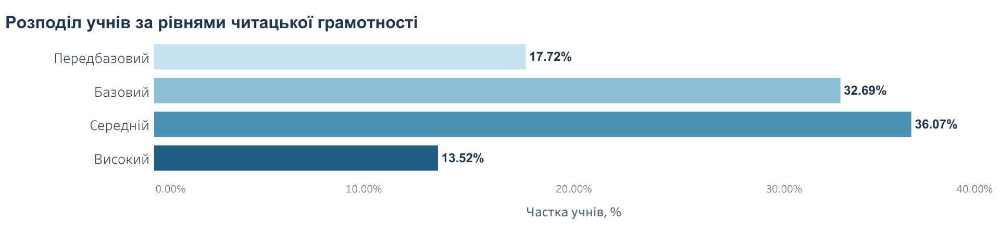
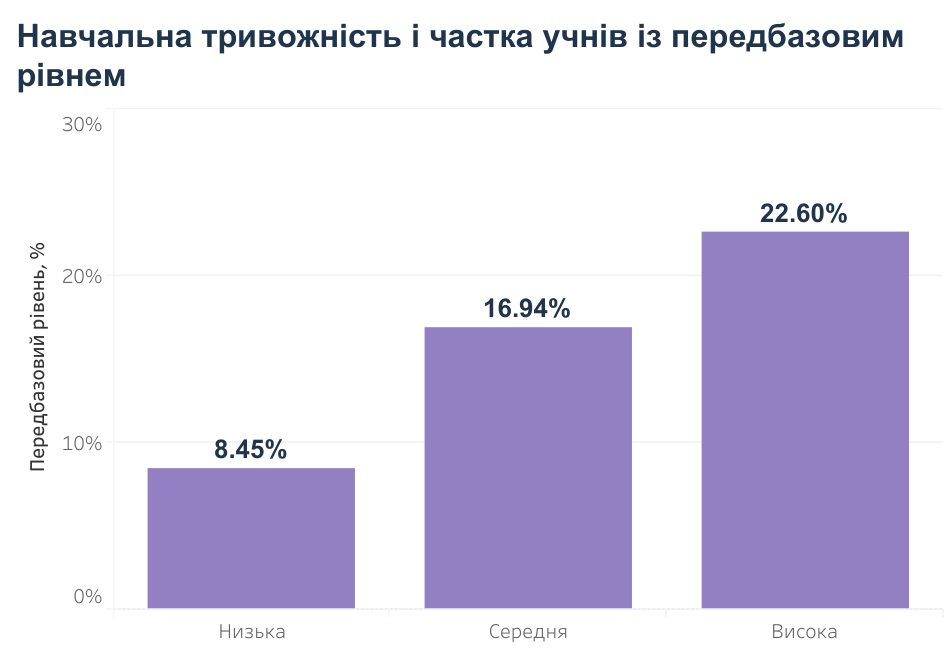
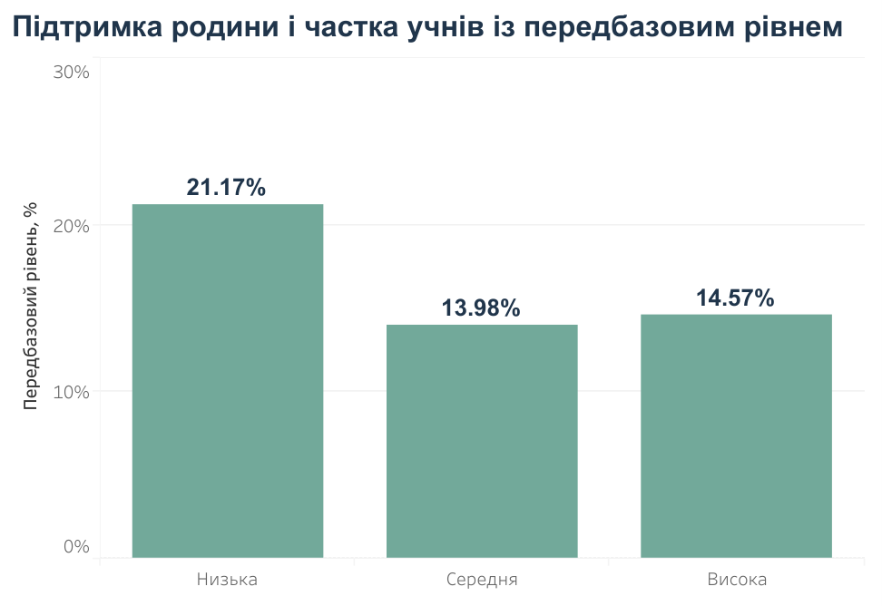
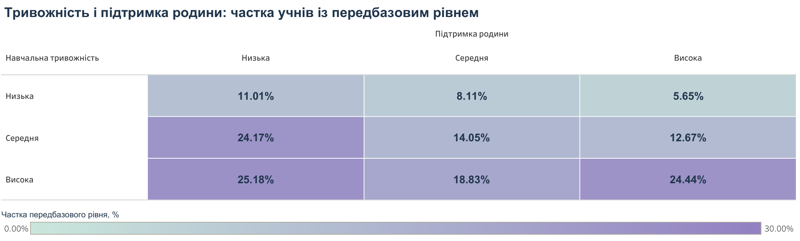
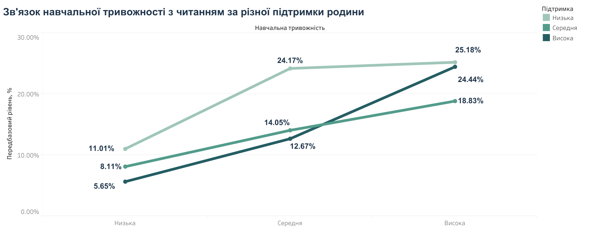

# Читацька грамотність четвертокласників України у 2024 році: зв'язок із навчальною тривожністю та підтримкою родини

**Аналітична доповідь | Навчальний проєкт стажування Data Analyst**  
**Період даних:** 2024 рік  
**Інструменти:** Google Sheets, SQL (SQLite / DBeaver), Tableau Public

## Анотація

Мета дослідження — з'ясувати, як результати читання четвертокласників, які брали участь у загальнодержавному моніторингу 2024 року, пов'язані з навчальною тривожністю та підтримкою родини. Проаналізовано знеособлені дані **3 602 учнів**, а для спільного порівняння двох показників — **3 392 учнів**, для яких обидва показники були наявні.

У загальній вибірці зважена частка учнів, які не досягли базового рівня читацької грамотності, становила **17,72%**. У дев'яти групах за поєднанням тривожності та підтримки родини цей показник коливався від **5,65%** до **25,18%**. Результати свідчать про помітні відмінності між групами, але не доводять, що тривожність чи підтримка самі по собі спричиняють ці відмінності.

## 1. Чому ця тема важлива

Уміння читати й розуміти прочитане потрібне дитині не лише на уроках мови, а й під час навчання інших предметів. Якщо учень не досягає базового рівня читацької грамотності, йому може бути важче працювати з навчальними завданнями та інформацією.

Окрім результату тестування, важливо розглядати умови, у яких навчається дитина. У цій роботі увагу зосереджено на двох показниках, наявних у даних моніторингу: **навчальній тривожності** та **підтримці родини**. Аналіз їхнього поєднання допомагає побачити, чи однаковими є результати читання в різних групах учнів.

## 2. Мета та дослідницькі питання

**Мета:** проаналізувати зв'язок навчальної тривожності та підтримки родини з читацькою грамотністю четвертокласників у 2024 році.

**Головне питання:** за яких поєднань навчальної тривожності та підтримки родини четвертокласники частіше не досягають базового рівня читацької грамотності?

Для відповіді на нього перевірено: (1) загальний розподіл рівнів читання; (2) відмінності за тривожністю; (3) відмінності за підтримкою родини; (4) дев'ять поєднань цих двох показників; (5) те, як змінюється картина за різного рівня підтримки.

## 3. Джерело даних і підготовка

Використано відкриті знеособлені дані **третього циклу загальнодержавного зовнішнього моніторингу якості початкової освіти (ЗЗМЯПО-2024)**, оприлюднені **Українським центром оцінювання якості освіти (УЦОЯО)**. Офіційний звіт третього циклу має назву **«Навчання в кризових умовах: читацька, математична та природничо-наукова компетентності випускників початкової школи»**. Сторінка зі звітами, статистичними даними та матеріалами: [УЦОЯО — Звіти / Дані](https://testportal.gov.ua/zvity-dani-2/).

Для аналізу читання використано файл `Student_read_24.csv` із робочого набору даних. Вихідна таблиця містила **3 602 записи та 144 поля**. Для SQL-аналізу залишено 11 необхідних полів, зокрема результат читання `SCORE_100_300`, рівень читання `BENCHMARK`, статистичну вагу `W_student`, навчальну тривожність `ANXI` і підтримку родини `SUPP`.

Дані перевірено в Google Sheets і SQL: кількість записів та унікальність ідентифікаторів, наявність пропусків, допустимі значення показників, діапазон оцінки читання **100–300** і додатність статистичних ваг. Порожні текстові значення в потрібних полях було перетворено на `NULL`. Відсутні оцінки тривожності чи підтримки **не замінювалися вигаданими значеннями**.

У вибірці не було значень `ANXI` у **156** учнів і `SUPP` — у **149** учнів. У **210** записах бракувало принаймні одного з цих двох показників, тому спільний аналіз проведено для **3 392 учнів**.

## 4. Як розраховували показники

Для читацької грамотності використано чотири рівні: **передбазовий**, **базовий**, **середній** та **високий** (`BENCHMARK` від 1 до 4). Основний показник — **зважена частка учнів передбазового рівня**, тобто тих, хто не досяг базового рівня. Чим вища ця частка, тим більша частина відповідної групи має труднощі з читанням.

Тривожність (`ANXI`) і підтримку родини (`SUPP`) розглядали у трьох категоріях: **низька**, **середня**, **висока**. Поєднання двох показників утворює **дев'ять груп**.

Для розрахунку часток і середніх балів застосовано статистичну вагу учня `W_student`:

- **Зважена частка передбазового рівня:** сума ваг учнів із `BENCHMARK = 1` / сума ваг усіх учнів відповідної групи × 100%.
- **Зважений середній бал:** сума добутків балу читання на вагу / сума ваг учнів відповідної групи.

Важливо: **кількість учнів** у таблицях — звичайна фактична кількість записів, а **відсотки й середні бали** розраховані з урахуванням ваг. Це різні показники, тому їх не слід прямо ототожнювати.

## 5. Результати дослідження

### 5.1. Загальний рівень читацької грамотності

*Рисунок 1. Розподіл учнів за рівнями читацької грамотності, зважені частки.*

Найбільша частка учнів досягла **середнього рівня (36,07%)**; ще **32,69%** — базового. Водночас **17,72%** учнів не досягли базового рівня. Частка високого рівня — **13,52%**. Зважений середній бал читання становить **197,91** зі шкали 100–300.

Результат **17,72%** узгоджується з опублікованим УЦОЯО узагальненням **17,7%** (різниця лише в округленні): [офіційна публікація](https://testportal.gov.ua/zzmyapo-2024-uspishnist-uchnivstva-v-galuzyah-matematyky-ta-chytannya/).

Отже, головне питання полягає не лише в тому, скільки учнів мають труднощі з читанням загалом, а й у тому, **в яких групах ці труднощі трапляються частіше**.

### 5.2. Навчальна тривожність і читання

*Рисунок 2. Частка учнів із передбазовим рівнем за рівнем навчальної тривожності.*

За низької тривожності частка учнів із передбазовим рівнем становить **8,45%**, за середньої — **16,94%**, за високої — **22,60%**. Різниця між крайніми групами — **14,15 відсоткового пункту**. Зважений середній бал також нижчий у групі з високою тривожністю (**192,33**), ніж у групі з низькою (**207,52**).

Таким чином, у досліджуваній вибірці **вища навчальна тривожність пов'язана з нижчими результатами читання**. Проте з цих даних неможливо встановити напрямок або причину такого зв'язку.

### 5.3. Підтримка родини і читання

*Рисунок 3. Частка учнів із передбазовим рівнем за рівнем підтримки родини.*

Найвища частка передбазового рівня зафіксована серед учнів із **низькою підтримкою родини — 21,17%**. У групі із середньою підтримкою показник становить **13,98%**, із високою — **14,57%**.

Отже, низька підтримка поєднується з менш сприятливими результатами читання. Водночас показник за високої підтримки **дещо вищий**, ніж за середньої, тому робити спрощений висновок «чим більше підтримки, тим кращі результати» некоректно.

### 5.4. Поєднання тривожності та підтримки родини

*Рисунок 4. Зважена частка передбазового рівня в дев'яти групах; темніші клітинки відповідають вищій частці.*

Це центральна частина дослідження: кожну категорію тривожності зіставлено з кожною категорією підтримки родини.

| Навчальна тривожність | Низька підтримка | Середня підтримка | Висока підтримка |
|---|---:|---:|---:|
| **Низька** | 11,01% (285 учнів) | 8,11% (489) | **5,65%** (323) |
| **Середня** | 24,17% (368) | 14,05% (589) | 12,67% (324) |
| **Висока** | **25,18%** (246) | 18,83% (485) | 24,44% (283) |

*У дужках наведено фактичну кількість учнів у групі; відсотки є зваженими.*

**Найменша частка — 5,65%** — спостерігається за поєднання низької тривожності з високою підтримкою родини. **Найбільша — 25,18%** — за високої тривожності та низької підтримки. Відмінність між цими двома групами становить **19,53 відсоткового пункту**.

Важливий результат: навіть за **високої підтримки** родини учні з **високою тривожністю** мають відносно високу частку передбазового рівня — **24,44%**. Отже, сімейна підтримка не обов'язково супроводжується низькою часткою труднощів із читанням у кожній групі.

### 5.5. Чи відрізняється картина за різної підтримки?

*Рисунок 5. Зв'язок навчальної тривожності з читанням за різних рівнів підтримки родини.*

Лінійний графік допомагає порівняти всі дев'ять значень одночасно. У кожній із трьох груп підтримки частка передбазового рівня **вища за високої тривожності, ніж за низької**. Проте розташування ліній показує, що відмінності між рівнями підтримки неоднакові.

За **низької тривожності** частка передбазового рівня зменшується від **11,01%** за низької підтримки до **5,65%** за високої. За **середньої тривожності** — від **24,17%** до **12,67%**. А за **високої тривожності** крайні значення значно ближчі: **25,18%** за низької підтримки та **24,44%** за високої.

Це описова закономірність у вибірці. Без додаткових статистичних перевірок її **не можна називати доведеною взаємодією** двох чинників.

## 6. Основні висновки

1. У загальній вибірці **17,72%** учнів не досягли базового рівня читацької грамотності.
2. **Вища навчальна тривожність** пов'язана з більшою часткою учнів передбазового рівня: від **8,45%** за низької до **22,60%** за високої.
3. За **низької підтримки родини** частка передбазового рівня вища, ніж у двох інших групах підтримки; однак зв'язок не є строго послідовним від низької до високої підтримки.
4. Найбільш і найменш сприятливі поєднання показників — відповідно **висока тривожність + низька підтримка (25,18%)** і **низька тривожність + висока підтримка (5,65%)**.
5. За високої тривожності навіть у групі з високою підтримкою родини частка передбазового рівня залишається високою (**24,44%**). Однієї ознаки підтримки недостатньо для простого прогнозування результатів читання.

## 7. Практичне значення

Результати підказують, на що варто звертати увагу під час підтримки дітей, які мають труднощі з читанням:

- **Учителям:** розглядати результати читання разом із навчальним самопочуттям учнів; пропонувати посильні завдання, зрозумілий зворотний зв'язок і своєчасну допомогу тим, кому читання дається важко.
- **Батькам:** підтримувати інтерес до читання без зайвого тиску, обговорювати прочитане й звертати увагу на тривожність дитини під час навчання.
- **Закладам освіти:** за потреби поєднувати роботу над читацькими навичками з психологічно безпечним навчальним середовищем та комунікацією з родинами.

Ці рекомендації є практичними орієнтирами, **а не перевіреними цим аналізом способами підвищення результатів читання**.

## 8. Обмеження дослідження

- Аналіз охоплює **учасників моніторингу 2024 року**, а не кожного четвертокласника України; використання статистичних ваг враховано в розрахунках часток і балів.
- Для спільного аналізу взято **3 392 із 3 602** записів. Дані учнів без значення `ANXI` або `SUPP` не ввійшли до відповідного порівняння.
- Тривожність і підтримка представлені **трьома категоріями**, що не передає всіх індивідуальних особливостей дітей та їхніх сімей.
- Дослідження має **описовий характер**: не обчислювали довірчих інтервалів, не виконували перевірок статистичної значущості та не враховували одночасно всі можливі чинники.
- Виявлені зв'язки **не доводять причинно-наслідкових залежностей**. Не можна стверджувати, що зміна підтримки чи тривожності автоматично змінить результат читання.

## 9. Джерела та матеріали проєкту

1. **Український центр оцінювання якості освіти (УЦОЯО).** Третій цикл загальнодержавного зовнішнього моніторингу якості початкової освіти (ЗЗМЯПО-2024): [офіційні звіти, статистичні дані й методичні матеріали](https://testportal.gov.ua/zvity-dani-2/).
2. **Робочий набір:** `Student_read_24.csv` (знеособлені записи учнів із результатами читання та показниками навчального середовища; посилання на офіційну сторінку набору — вище).
3. **SQL-запити:** [sql/analysis.sql](sql/analysis.sql).
4. **Дашборд Tableau у PDF:** [dashboard/Reading_Literacy_Dashboard.pdf](dashboard/Reading_Literacy_Dashboard.pdf).

**Примітка до графіків:** зображення експортовані з підготовленого дашборду Tableau. Значення у звіті подано з двома знаками після коми. Повноцінні вихідні індивідуальні записи учнів та їхні ідентифікатори в цьому публічному репозиторії не розміщено.
